# Atlantis Explorer – Fanprojekt

Ein im Browser spielbarer Nachbau der Stadt Atlantis aus *Stargate Atlantis*: begehbare Räume und Gänge,
Transporter, ein funktionierendes Stargate mit Reise zu einem Fremdplaneten und ein fliegbarer Puddle Jumper –
dazu eine Datenbank mit allen Räumen, Objekten, Beschreibungen und 3D-Modellen samt REST-API.

> **Inoffizielles, nicht-kommerzielles Fanprojekt.** Stargate Atlantis und alle zugehörigen Namen, Designs und Marken
> gehören den jeweiligen Rechteinhabern (MGM / Amazon MGM Studios). Dieses Projekt ist mit ihnen nicht verbunden und
> wird von ihnen nicht unterstützt. Es enthält keine Bilder, Videos oder Tonaufnahmen aus der Serie.
> Details zu Vorlagen und Lizenzen: [CREDITS.md](CREDITS.md).

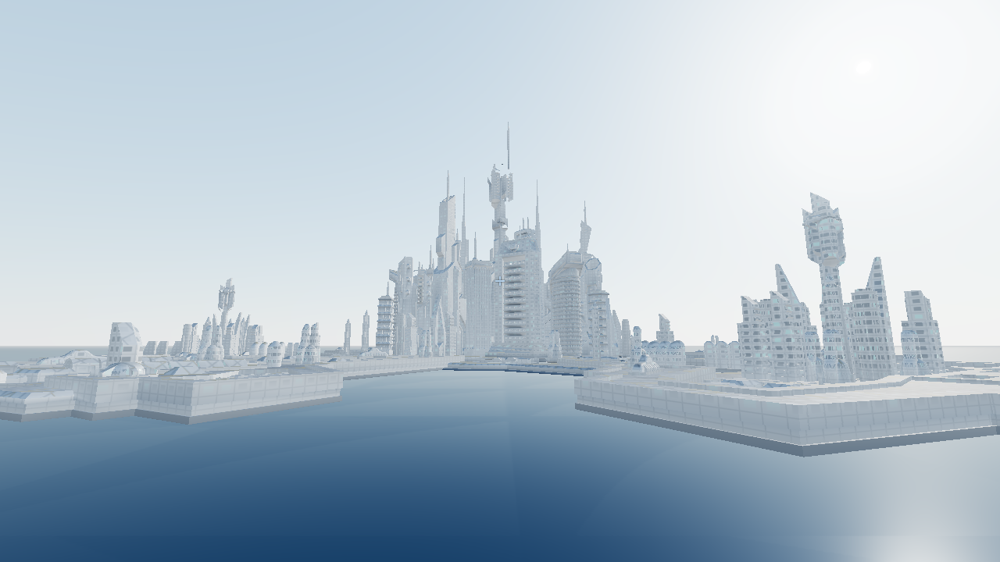

## Was es gibt

- **Die Stadt** (≈ 1,3 km Durchmesser) mit Hauptturm und sechs Piers, als Außenhülle in voller Auflösung, umgeben von Meer.
- **46 Räume und 58 Gangstücke**, die beim Bewegen nachgeladen werden – Torhalle mit Kontrollraum, Jumper-Bucht,
  Krankenstation, ZPM-Raum, Stuhlraum, Quartiere, Labore und vieles mehr; rund 100 verschiedene Objekte.
- **15 Transporter**, die die Bereiche der Stadt verbinden.
- **Stargate:** Adresse wählen (Stargate oder DHD), Kawoosh, Ereignishorizont, durchgehen – auf einem Fremdplaneten
  mit eigenem DHD ankommen und zurückwählen.
- **Puddle Jumper:** einsteigen, die Luken der Jumper-Bucht öffnen sich beim Durchfliegen, Antriebsgondeln, Drohnen,
  Tarnung, aussteigen und wieder einsteigen.
- **Datenbank + API** (FastAPI): Räume, Objekte, Beschreibungen, Stadtplan und Modelle, mit Weboberfläche.

| | |
|---|---|
| 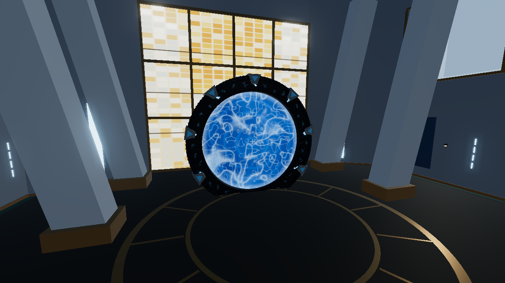 | 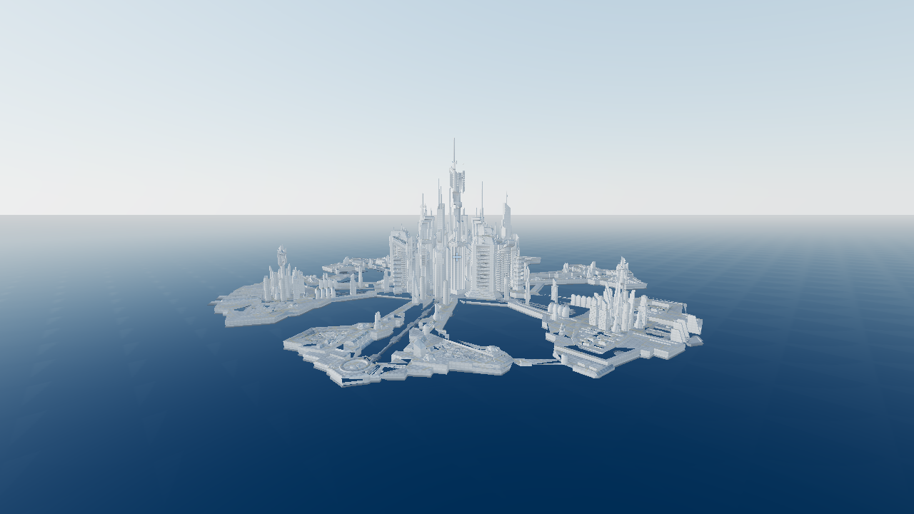 |
| *Torhalle mit offenem Wurmloch* | *Die Stadt von oben* |
| 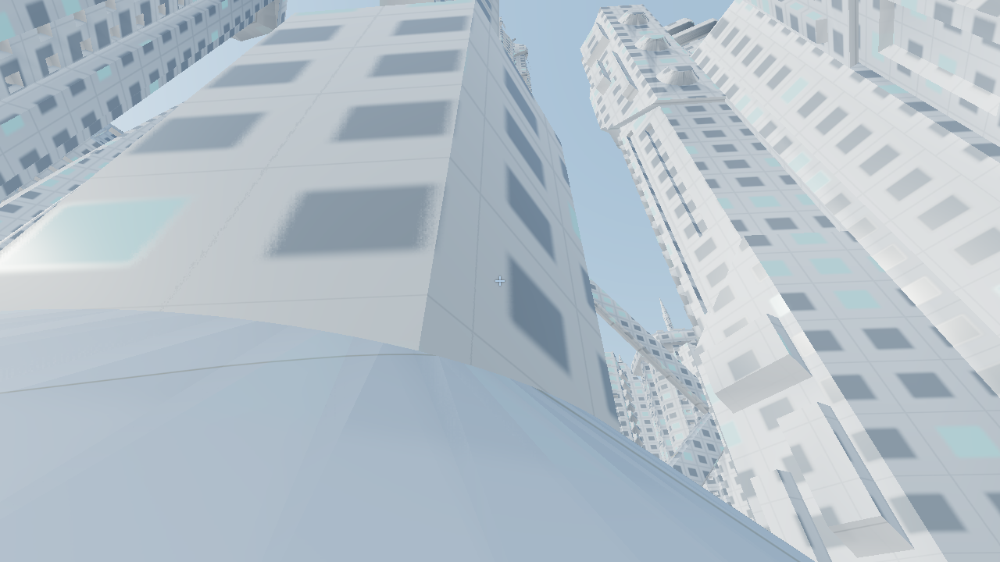 | 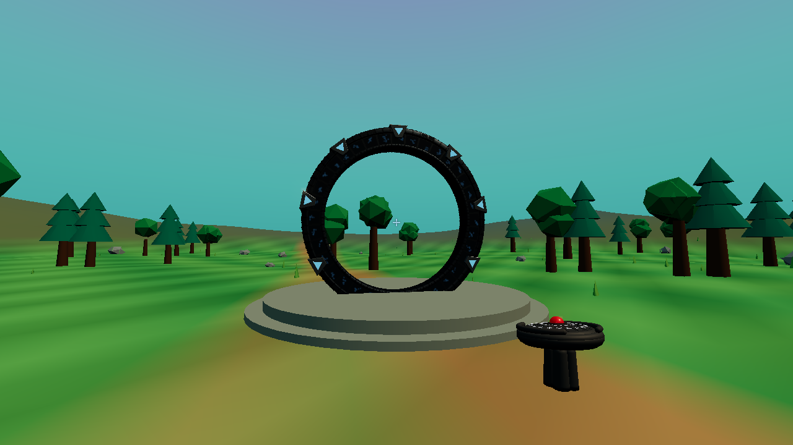 |
| *Zwischen den Türmen* | *Fremdplanet mit DHD* |

### Räume (Aufnahmen aus dem Spiel)

| | |
|---|---|
| 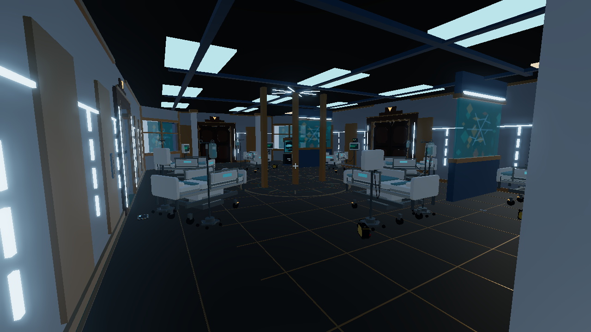 | 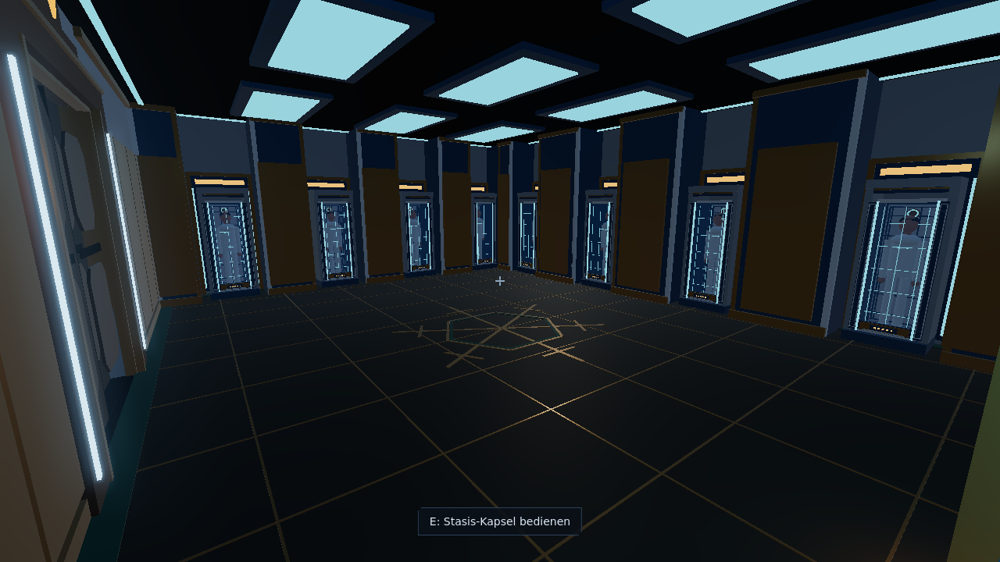 |
| *Krankenstation* | *Stasiskammer* |
| 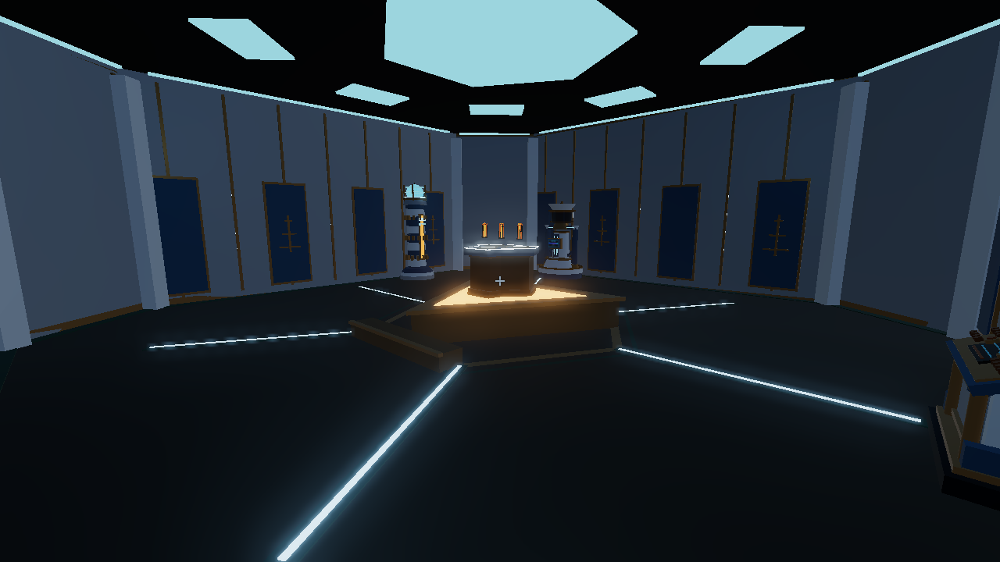 | 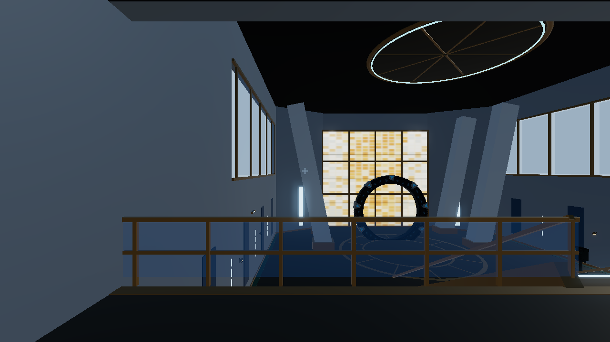 |
| *ZPM-Raum* | *Kontrollraum* |

### Objekte (3D-Modelle)

| | | |
|---|---|---|
| 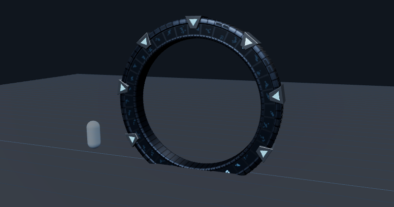 | 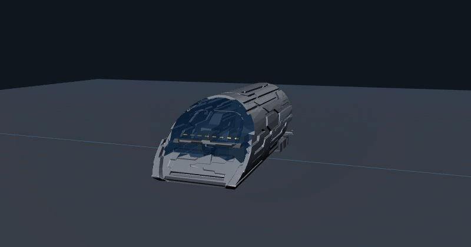 | 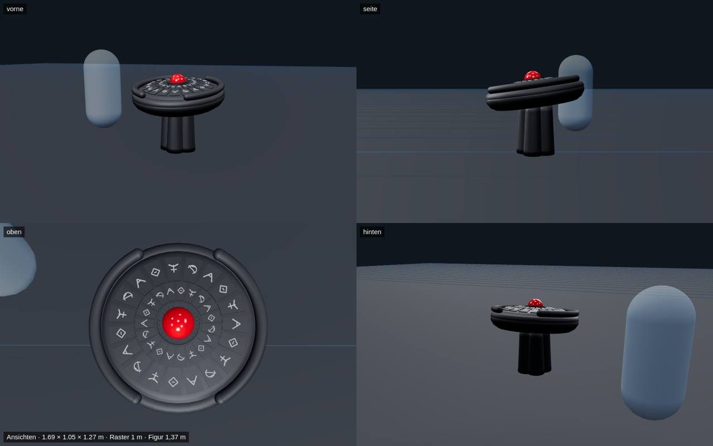 |
| *Stargate* | *Puddle Jumper (Heckklappe offen)* | *DHD (Fremdwelten)* |

## Starten

Voraussetzung: Docker.

```bash
git clone https://github.com/bmetallica/atlantis-explorer-fanprojekt.git
cd atlantis-explorer-fanprojekt
docker compose up -d --build
```

- Spiel: <http://localhost:8324/spiel/>
- Datenbank-Oberfläche: <http://localhost:8324/ui/>
- API-Dokumentation: <http://localhost:8324/docs>

Der erste Start lädt die Stadthülle (≈ 40 MB). Auf schwacher Grafik (z. B. Laptop mit integrierter Grafik) wählt das
Spiel automatisch die Grafikstufe „Niedrig“; umstellen lässt sie sich im Menü (Esc → Einstellungen).

## Steuerung

| Taste | Zu Fuß | Im Jumper |
|---|---|---|
| W A S D / Maus | laufen, umsehen | W/S Schub, A/D drehen, Maus neigen |
| Leertaste / Strg | springen / ducken | steigen / sinken |
| Umschalt | rennen | Boost |
| E | benutzen (Türen, Stargate, DHD, Transporter, Jumper) | aussteigen (am Boden) |
| F | – | Drohne abfeuern |
| V | – | Cockpit- / Verfolgeransicht |
| Esc | Menü (Einstellungen, Steuerung, Credits) | |
| F3 | Leistungsanzeige | |

Hüllen-Varianten der Stadt lassen sich über die Adresse wählen, z. B. `/spiel/?huelle=deepseek2`
(`claude`, `minimax`, `glm`, `deepseek`, `minimax2`, `glm2`, `deepseek2`).

## Aufbau

```
src/app.py            FastAPI: Datenbank-API, Stadtplan, Auslieferung von Spiel und Modellen
src/game/             Spiel (three.js r170, ES-Module): core/ (Engine, Assets, Licht, Verdeckung, Innen/Außen …),
                      welt/ (Nachladen, Kollision, Außenwelt, Planet), spieler/ (Steuerung, Benutzen, Torreise, Jumper), ui/
src/ui/               Weboberfläche der Datenbank
data/rooms.json       Räume und Objekte (Beschreibungen, Maße, Einbau-Hinweise)
data/models/          3D-Modelle aller Räume und Objekte als JS-Module (prozedural, three.js)
data/stadtplan.json   Lage aller Räume, Gänge, Transporter und Verbindungen
data/stadt/aussen/    Außenhülle der Stadt (Kacheln, volle und vereinfachte Stufe)
build/                Anleitungen, Orchestrator für KI-gestützten Modellbau, Werkzeuge (Stadtplan, Einpassung, Prüfstand)
```

Technische Eckpunkte: Räume werden um den Spieler nachgeladen und über mehrere Bilder verteilt aufgebaut,
gleichartige Teile zu BatchedMesh gebündelt, Lichter über einen festen Lichtpool verteilt, verdeckte Räume per
Occlusion Query ausgeblendet; Kollision mit three-mesh-bvh.

## Credits

Stadtmodell „Atlantis From Stargate Atlantis“ von **taichl** und Puddle-Jumper-Vorlage, beide unter
**Creative Commons – Namensnennung (CC BY)**, für das Spiel verändert. Vollständige Angaben: [CREDITS.md](CREDITS.md).
